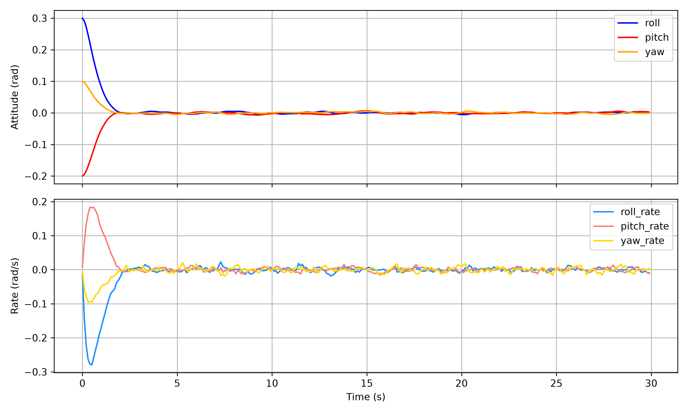

# Satellite Attitude Dynamics Simulation with PD Controller

Modular C++ simulation of satellite attitude dynamics controlled by a PD controller. Includes sensor noise, angle wrapping, CSV telemetry logging, automated gain tuning, and Python plotting.

## What This Project Demonstrates
- Flight software structure (modular C++, clear interfaces, testing)
- Basic guidance, navigation, and control (GNC) using PD attitude control
- Handling of sensor noise versus true state
- Data logging and post-processing
- Automated parameter tuning

## How to Build and Run
From the main folder:

.\build.ps1

Or manually:

g++ -std=c++17 -Iinclude src/*.cpp -o attitude_sim.exe
.\attitude_sim.exe              # default gains
.\attitude_sim.exe 54 41        # custom gains

## Plotting and Tuning
python python/plot_results.py   # generate attitude_response.png
python python/tune_gains.py     # grid-search for kp and kd

## Current Behavior
- PD controller with command-line override for gains
- Sensor noise applied to measurements only (true dynamics remain clean)
- Attitude error wrapped to [-pi, pi]
- True state logged to telemetry.csv
- Python-based grid search for proportional and derivative gains

## Results
Automated grid search and manual evaluation identified a high-performance set of gains (kp = 54, kd = 41). With these values the satellite settles to the commanded attitude in roughly 3 seconds with minimal overshoot.

Higher gains produce faster response but increase sensitivity to sensor noise, appearing as small high-frequency jitter in the rates after settling. This is a classic control tradeoff. The plot attitude_response.png shows the closed-loop behavior. The system remains stable and reaches the target even with measurement noise.

## Structure
- src/ — C++ simulation and controller
- include/ — Headers
- python/ — Plotting and tuning scripts
- tests/ — Unit tests

## Unit Test
g++ -std=c++17 -Iinclude tests/test_controller.cpp src/controller.cpp -o test_controller.exe
.\test_controller.exe

Expected output: Controller unit test passed